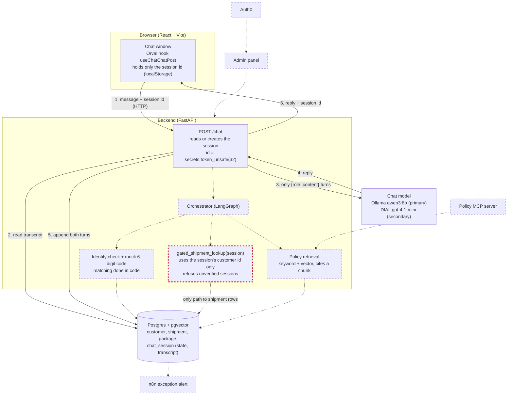

# Architecture sketch — SecureShip

DRAFT — written after the async design check was sent on 2026-11-09; will be updated after mentor feedback.

## The parts that exist

These are given by the contract. How they connect is yours.

- The visitor's chat window
- The backend
- The chat model runtime (Ollama or DIAL)
- Postgres: customers, shipments, packages, chat sessions, and later your policy chunks
- Auth0, for the admin panel only
- The admin panel
- An n8n workflow, from Week 2
- A policy MCP server, from Week 4

## Draw it

Draw your sketch as a Mermaid diagram below, or paste a photo of a drawing. Start with the visitor's message and follow it until the reply comes back. Show where the session is kept. Show the one place the rule about shipment data is enforced. Leave out anything you have not decided yet.

## Questions to answer next to it

- **Transport.** HTTP. One request per message fits Orval + React Query, and the access rule is the same either way; WebSockets add complexity I don't need yet.
- **Runtime.** Ollama `qwen3:8b` as primary: it runs locally, costs nothing and needs no VPN. DIAL `gpt-4.1-mini` is the secondary runtime (VPN only, shared 40 USD allowance). Embeddings always use Ollama `nomic-embed-text`.
- **Session state.** In Postgres, table `chat_session` (state + transcript). The id is created on the server with `secrets.token_urlsafe(32)`. The browser holds only that id in localStorage — no verified flag, no customer id, no keys.
- **Shipment rule.** `gated_shipment_lookup(session)` in the backend (Week 3). It takes the server-side session, uses the session's customer id, and refuses unverified sessions before any query. It never accepts a customer id from the model, the request body or the user's text.
- **What the model sees / never sees.** Sees: the conversation turns as `{role, content}` and (later) retrieved policy chunks and tool results. Never sees: the customer id, the 2FA code, attempt counts, timestamps or the verified flag.
- **Expected changes before the final sketch.** The dashed parts become real: the orchestrator steps, the identity check + code, the gated lookup, retrieval (keyword + vector), the n8n alert, Auth0 + admin panel, and the MCP server. Mentor feedback from the design check may also change the flow. In Week 4 this sketch is replaced with diagrams generated from the shipped code.

Week 1 is ungated on purpose. The identity check and the shipment tool come in Weeks 2 and 3, so your sketch can show them as dashed boxes.
